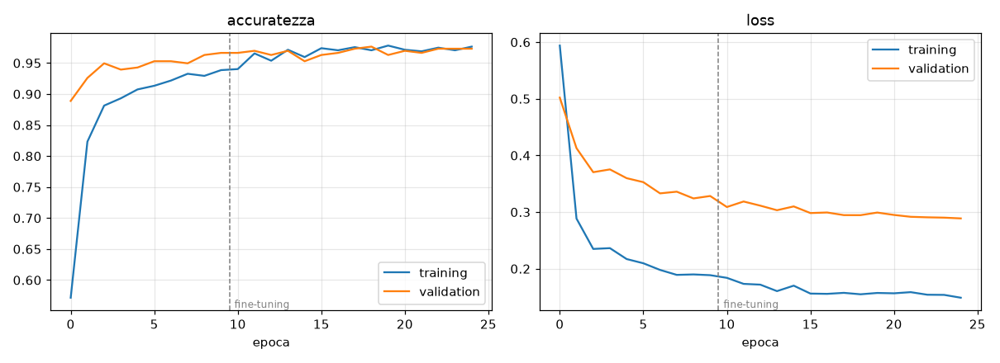

# Modello di visione di BusSense

Documentazione della rete neurale che riconosce **buche**, **cassonetti pieni** e **rifiuti
abbandonati** nelle foto del telefono, e che gira in locale sulla Arduino UNO Q (edge computing).

| | |
|---|---|
| Versione in uso | **v2** (`bussense_int8`), 11 ottobre 2026 |
| Compito | classificazione di immagini, 4 classi |
| Rete | MobileNetV2 (α = 1.0, 224×224), pre-addestrata su ImageNet, fine-tuning |
| Formato sulla board | TensorFlow Lite (LiteRT), quantizzato **int8**, 2,6 MB |
| Accuratezza (validation) | **98,0%** (int8, codice della board) |
| Tempo per foto sulla UNO Q | **41 ms** mediana (benchmark), 82 ms medi in esercizio |
| File | `unoq-app/python/models/bussense_int8.tflite` + `labels.txt` |
| Codice | addestramento in `ml/`, inferenza in `unoq-app/python/bussense/classifier.py` |

---

## 1. Dove sta nel sistema

```
TELEFONO (Galaxy A26)                          ARDUINO UNO Q
                                               ┌───────────────────────────────────────────┐
fotocamera ─► 1 foto ogni ~4 m      WebSocket  │ receiver.py   foto solo in RAM             │
(1/s in modalità demo)  ──────────────────────►│ vision.py     coda da 1 foto               │
GPS 1 Hz                                       │ classifier.py ritaglio → 224×224 → MODELLO │
                                               │                ▼                           │
                                               │   "buca" 0.93  →  soglia 0.70              │
                                               │                →  2 foto su 3 concordi     │
                                               │                →  niente doppioni 20 m/60 s│
                                               │ rx.report()   + posizione + sensori MCU    │
                                               │ cloud.py      coda su disco, nuovi tentativi│
                                               └───────────────────┬───────────────────────┘
                                                                   │ HTTPS, chiave API
                                                                   ▼
                                                 TorinoSegnala  POST /api/v1/reports
```

Il modello non vede mai la rete: riceve un JPEG e restituisce quattro probabilità. Tutto il resto
(soglia, conferma, deduplica, posizione, invio) è in `vision.py` e `cloud.py`.

**Perché sulla board e non sul cloud.** Le foto contengono volti e targhe: restano in RAM sulla UNO Q
e non vengono mai salvate né inviate. Alla piattaforma arriva solo l'esito (categoria, confidenza,
posizione). Funziona anche senza rete: le segnalazioni si accodano e partono dopo.

---

## 2. Architettura della rete

```
ingresso  224×224×3 uint8, pixel 0–255
   │
   ├─ Rescaling            x / 127.5 − 1  → valori in [−1, 1]         (dentro il modello)
   │
   ├─ MobileNetV2 α=1.0    154 strati, 2.257.984 parametri, pesi ImageNet
   │    conv 3×3 stride 2 (32 canali)
   │    17 blocchi "inverted residual":
   │       espansione 1×1  →  depthwise 3×3  →  proiezione 1×1 (lineare)
   │       ReLU6 dopo espansione e depthwise, scorciatoia residua se le forme coincidono
   │    conv 1×1 finale (1280 canali)
   │    uscita 7×7×1280
   │
   ├─ GlobalAveragePooling  → vettore di 1280 caratteristiche
   ├─ Dropout 0.3           (solo in addestramento)
   └─ Dense 4, softmax       5.124 parametri  → P(buca), P(cassonetto_pieno), P(normale), P(rifiuti)

totale: 2.263.108 parametri
```

**Perché MobileNetV2.** È progettata per CPU deboli: le convoluzioni *depthwise separable* costano una
frazione di quelle normali. Rispetto a MobileNetV3 o EfficientNet ha un vantaggio decisivo per noi:
usa solo **ReLU6**, che si quantizza a 8 bit quasi senza perdite, mentre hard-swish e i blocchi
squeeze-excite di V3 hanno intervalli di valori che l'int8 rappresenta male. La UNO Q non ha una NPU
usata da LiteRT: tutto gira sui 4 core Cortex-A53, e qui l'int8 fa la differenza.

**Perché un classificatore e non un detector (YOLO).** Il PIANO prevedeva un detector Edge Impulse.
Un detector dà anche i riquadri, ma richiede immagini annotate con bounding box, che il dataset non
ha: è organizzato a cartelle per classe. Per una segnalazione basta sapere *che cosa* c'è nella foto,
perché *dove* lo dice il GPS.

**Perché la normalizzazione è dentro il modello.** Il layer `Rescaling` fa parte del file `.tflite`,
che quindi accetta pixel 0–255 così come escono dal JPEG. Sulla board non c'è preprocessing da tenere
allineato con il PC: è il modo più comune in cui un modello "che funzionava" smette di funzionare sul
campo.

### Il modello quantizzato (int8)

Il file sulla board contiene **69 operatori**: 35 `CONV_2D`, 17 `DEPTHWISE_CONV_2D`, 11 `ADD`
(scorciatoie residue), più `MEAN` (pooling), `FULLY_CONNECTED`, `SOFTMAX` e 2 `QUANTIZE`.
Pesi e attivazioni sono interi a 8 bit; ingresso e uscita sono `uint8`.

| Tensore | Tipo | Quantizzazione | Significato |
|---|---|---|---|
| ingresso | `uint8 [1,224,224,3]` | scala 1.0, zero 0 | i pixel così come sono |
| uscita | `uint8 [1,4]` | scala 1/256, zero 0 | probabilità = valore / 256 |

| Formato | Dimensione | Accuratezza |
|---|---|---|
| Keras float32 (`modello.keras`) | 22,5 MB | 97,6% |
| TFLite float32 | 8,7 MB | 97,6% |
| **TFLite int8 (sulla board)** | **2,6 MB** | **98,0%** |

La quantizzazione è **calibrata su 300 immagini vere** del training: il convertitore fa girare la rete
su quelle foto, misura l'intervallo di valori di ogni strato e ne ricava le scale. Il +0,3 punti
dell'int8 rispetto al float rientra nel rumore di 297 immagini di validation: significa che la
quantizzazione non costa nulla, non che migliora il modello.

---

## 3. Dati di addestramento

| Classe | Immagini | Train / val | Fonte | Licenza |
|---|---|---|---|---|
| `buca` | 90 | 72 / 18 | keremberke/pothole-segmentation (Roboflow Universe) | CC BY 4.0 |
| `cassonetto_pieno` | 600 | 480 / 120 | Akhila-9849/Garbage_Bin_overflow_images (Roboflow, M. Deepak) | CC BY 4.0 |
| `rifiuti` | 600 | 480 / 120 | Akhila-9849/waste_littering (TACO, Proença & Simões) | CC BY 4.0 |
| `normale` | 195 | 156 / 39 | frame del telefono BusSense, raccolti sulla board | team |
| **totale** | **1.485** | **1.188 / 297** | | |

**La classe `normale` è indispensabile.** Un softmax distribuisce sempre il 100% fra le classi che
conosce: senza una classe "niente da segnalare", una foto di un tavolo *deve* diventare buca, rifiuti
o cassonetto. È successo davvero (vedi §6, versione v1).

**Preparazione** (`ml/prepare_data.py`):
- scarto dei file illeggibili e rotazione EXIF applicata;
- deduplica percettiva (*dHash* 16×16): lo stesso scatto ricodificato o ridimensionato finirebbe sia
  in training sia in validation, gonfiando l'accuratezza. Sul dataset attuale: 0 doppioni;
- split stratificato 80/20 riproducibile (seed 1234), immagini salvate a 512 px di lato massimo.

I frame `normale` non sono oscurati: `dataset/normale/` è nel `.gitignore` perché il repo è pubblico.

---

## 4. Addestramento

Su PC con GPU **RTX 4050** (6 GB), TensorFlow 2.20 con CUDA in **WSL2**: Smart App Control di Windows
blocca le librerie di TensorFlow, e TensorFlow non supporta la GPU su Windows nativo dalla 2.11.
Durata: pochi minuti.

**Preprocessing, identico in training e sulla board:** ritaglio del quadrato centrale, poi resize
bilineare a 224×224. I frame del telefono non sono quadrati (640×360 orizzontali, 640×853 verticali):
schiacciarli in un quadrato deformerebbe buche e cassonetti rispetto alle foto di addestramento. È il
problema citato nel PIANO (§6.6), dove un altro team ha perso il 30–40% di accuratezza.
La funzione è una sola, `bussense.classifier.preprocess`, usata anche da export e valutazione.

**Data augmentation**, pensata per una fotocamera su un bus:

| Trasformazione | Intensità | Perché |
|---|---|---|
| ribaltamento orizzontale | sì | una buca a sinistra o a destra resta una buca |
| rotazione | ±0,06 giri (~±20°) | telefono non perfettamente dritto |
| zoom | ±15% | distanza variabile |
| traslazione | ±10% | inquadratura imprecisa |
| luminosità | ±25% | sole, ombra, nuvole |
| contrasto | ±25% | asfalto bagnato o abbagliato |

Niente ribaltamento verticale: le foto di strada hanno un sopra e un sotto.

**Due fasi:**

| | Fase 1: testa | Fase 2: fine-tuning |
|---|---|---|
| strati addestrabili | solo `Dense` (5.124 parametri) | + ultimi 40 strati del backbone, da `block_12` a `out_relu` (1,66 M parametri) |
| BatchNorm | congelati | **congelati** (con batch da 32 le statistiche ricalcolate peggiorano il modello) |
| learning rate | 1e-3 | **1e-5** (più alto cancellerebbe le caratteristiche di ImageNet) |
| epoche | 10 | 15 |

Scongelare subito tutto, con una testa che parte da pesi casuali, distruggerebbe le caratteristiche
pre-addestrate già ai primi gradienti: per questo prima si stabilizza la testa.

**Altri accorgimenti:**
- *loss* entropia incrociata con **label smoothing 0,05**: le etichette prese dal web sono rumorose, e
  impedire al modello la certezza assoluta lo rende più facile da tarare con una soglia;
- **pesi di classe** inversamente proporzionali alla frequenza (buca 2,27; normale 1,05; cassonetto e
  rifiuti 0,34): senza, "rispondi sempre la classe più numerosa" sarebbe già una buona strategia;
- early stopping sulla val accuracy (pazienza 8) e learning rate dimezzato quando la val loss si ferma;
- batch 32, ottimizzatore Adam.



Le curve di training e validation salgono insieme e restano vicine: **non c'è overfitting**. La val
loss resta sopra quella di training per effetto di label smoothing, dropout e augmentation, che
agiscono solo in training. La riga tratteggiata segna l'inizio del fine-tuning, che porta gli ultimi
2–3 punti.

---

## 5. Risultati

Valutazione con `ml/evaluate.py` sulle **297 immagini di validation**, mai viste in addestramento,
usando **lo stesso codice di preprocessing e inferenza della board**.

**Matrice di confusione (int8):**

| vera ↓ / predetta → | buca | cassonetto | normale | rifiuti | corrette |
|---|---|---|---|---|---|
| buca | **18** | 0 | 0 | 0 | 100% |
| cassonetto_pieno | 0 | **118** | 0 | 2 | 98% |
| normale | 0 | 0 | **39** | 0 | 100% |
| rifiuti | 2 | 2 | 0 | **116** | 97% |

| Classe | Precision | Recall | F1 |
|---|---|---|---|
| buca | 90,0% | 100,0% | 94,7% |
| cassonetto_pieno | 98,3% | 98,3% | 98,3% |
| normale | 100,0% | 100,0% | 100,0% |
| rifiuti | 98,3% | 96,7% | 97,5% |

L'unica confusione è fra **rifiuti e cassonetto pieno**, che si somigliano davvero (sacchi accanto a un
cassonetto). La precision delle buche al 90% dipende da 2 foto di rifiuti scambiate per buche su sole
18 buche in validation: con così pochi esempi ogni errore pesa 5 punti.

**Scelta della soglia.** Sulla board una foto può aprire una segnalazione solo se la classe più
probabile supera la soglia (`BUSSENSE_VISION_CONF`, default **0,70**):

| Soglia | Foto segnalate | Corrette | Falsi allarmi su `normale` |
|---|---|---|---|
| 0,50 | 254 | 97,6% | 0 |
| 0,60 | 246 | 98,8% | 0 |
| **0,70** | **235** | **99,6%** | **0** |
| 0,80 | 225 | 99,6% | 0 |
| 0,90 | 189 | 100,0% | 0 |

Sono valori per singola foto. Sulla board si aggiunge la **conferma 2 foto su 3** consecutive, che
abbatte ulteriormente gli errori isolati.

**Sulla UNO Q** (Debian 13, Python 3.13, `ai-edge-litert` 2.3.0, 4 thread):

| Misura | Valore |
|---|---|
| benchmark, 50 inferenze sulla stessa foto | **41 ms** mediana (39–43), decodifica JPEG compresa |
| in esercizio, frame veri del telefono | **82 ms** medi (frame più grandi, app e rete in parallelo) |
| prima inferenza (allocazione) | ~350 ms |
| 7 foto di validation di prova | 7/7 corrette, confidenza 87–99,6% |

Il telefono manda al massimo 1–2 foto al secondo: il margine è di oltre 10 volte. Se l'inferenza
restasse indietro, `vision.py` scarta le foto vecchie e tiene sempre l'ultima.

---

## 6. Versioni

| | v1 | **v2 (in uso)** |
|---|---|---|
| Data | 11/10/2026 | 11/10/2026 |
| Classi | buca, cassonetto_pieno, rifiuti | + **normale** |
| Immagini | 1.290 | 1.485 |
| Accuratezza val (int8) | 96,9% | 98,0% |
| Prova dal vivo, telefono che inquadra una stanza | **11 falsi allarmi in 7 minuti** | **0 su 127 foto** |

La v1 è la dimostrazione pratica del perché serve `normale`: inquadrando tavoli, zaini e persone
segnalava "cassonetto" e "rifiuti" con confidenza fino a 0,98. Quei falsi allarmi sono rimasti in
locale (la chiave API non era ancora configurata) e sono stati marcati come rifiutati nella coda di
invio: non arriveranno mai alla piattaforma.

---

## 7. Limiti noti

Da leggere prima di fidarsi dei numeri del §5.

1. **I negativi vengono da una sola stanza.** I 195 frame `normale` sono stati ripresi in pochi minuti
   nella sala dell'hackathon. Validation e training si somigliano molto, quindi il 100% su `normale` è
   ottimista. Sulla strada vera, asfalto, marciapiedi e auto **non sono mai stati visti** come
   negativi: vanno raccolti dal bus prima di un uso reale.
2. **Positivi dal web, negativi dal telefono.** Il modello potrebbe imparare a distinguere la *fonte*
   ("foto da telefono = normale") invece del contenuto. La prova con una foto di buca mostrata a
   schermo e ripresa dal telefono verifica proprio questo. Il rimedio vero sono buche e rifiuti
   fotografati dal bus.
3. **Poche buche.** 90 immagini, e sono quasi tutte primi piani. La buca è la classe più importante del
   progetto: servono altre fonti (RDD2022, classe D40, citata nel PIANO) e buche vere di Torino.
4. **Bordi del frame ignorati.** Il ritaglio centrale scarta circa il 22% per lato di un frame
   orizzontale. Per le buche al centro della carreggiata conta poco, per i cassonetti a bordo strada di
   più. Se diventa un limite, si classificano due ritagli (sinistro e destro) per frame.
5. **Una classe per foto.** Il classificatore restituisce la classe più probabile: se nella stessa
   foto ci sono una buca e dei rifiuti, ne segnala una sola.
6. **Validation piccola.** 297 immagini, 18 buche: le percentuali hanno un margine di qualche punto.

---

## 8. Come rifare tutto

Da WSL, nella cartella `ml/` (dettagli in [`ml/README.md`](../ml/README.md)):

```bash
python prepare_data.py --dataset ../dataset   # pulizia, deduplica, split
python train.py                               # ~5 minuti su RTX 4050
python export_tflite.py --app                 # int8 → unoq-app/python/models/
python evaluate.py                            # numeri del §5, soglia
```

Poi copiare `unoq-app/python/models/` sulla board e riavviare l'app. Per raccogliere nuovi negativi:
`BUSSENSE_DEBUG_SAVE_FRAMES=1` in `data/bussense.env` sulla board, i frame finiscono in
`data/debug_frames/`, e va **rimesso a 0** subito dopo, perché salva foto non oscurate.

Prova del modello direttamente sulla board, dalla cartella `python/` dell'app:

```bash
python -m bussense.classifier foto.jpg
python -m bussense.classifier foto.jpg --benchmark 50
```
